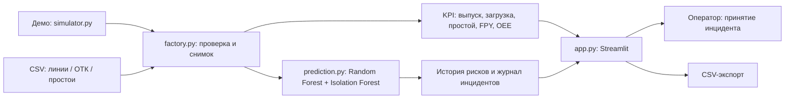

# Архитектура решения по кейсу 2

## MVP

Синхронный снимок — по одной строке на станцию. Валидатор проверяет структуру, диапазоны, целочисленные счётчики, соответствие топологии, пробелы телеметрии и единое окно. Ошибка импорта сохраняет предыдущее состояние. Предсказания вычисляются только после проверки. ML обучается один раз и кэшируется процессом Streamlit. Состояние каждого посетителя независимо в session_state.

Жизненный цикл инцидента: открытие → принятие в работу → автоматическое устранение после нормализации. Сигналы риска, остановки и отсутствия данных ведутся отдельно. Один активный ID на станцию и тип; повторное событие после устранения создаёт новый ID. Принятие в работу не означает устранение физического дефекта.

UI обновляется раз в 3 секунды при включённом автообновлении. Ручной CSV не имитирует поток живых PLC. История содержит до 240 снимков, журнал — историю текущей сессии.

## Промышленный пилот

MES/PLC/SCADA/ОТК → read-only адаптеры OPC UA / MQTT / API → нормализация времени и единиц → очередь событий → PostgreSQL/TimescaleDB → сервис KPI/ML → API/WebSocket → интерфейс и аудит.

MVP не реализует перечисленные адаптеры и хранилище. Подключение к контроллерам требует согласования с заводом. На пилоте необходимы единые метки времени, контроль свежести и пропусков, оборудование/смена/модель автомобиля в идентификаторах, фактические номиналы, отделение планового обслуживания от аварийных простоев, аутентификация и роли, постоянный журнал решений.

Для ИИ: собрать исторические интервалы оборудования и метки отказов/дефектов; временное разбиение train/validation/test; проверить утечки признаков; оценить recall отказов, precision предупреждений и фактический горизонт опережения. Сравнить с базовыми порогами. Перед операционным использованием откалибровать вероятности и согласовать пороги с операторами.
