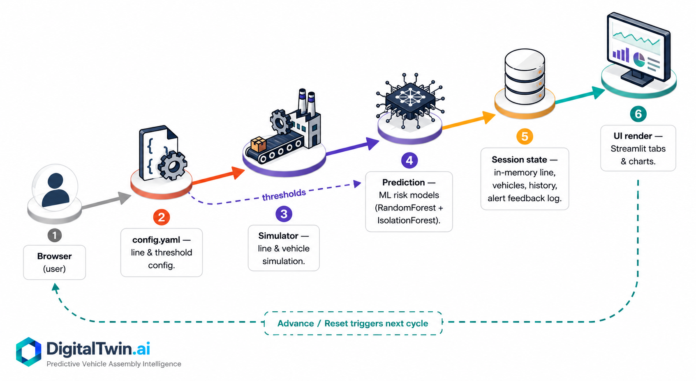

# DigitalTwin.ai — Predictive Vehicle Assembly Digital Twin

> **Predict problems before they stop the line.**

🔗 **Repository:** [github.com/Vishal-Dabhade/DigitalTwin-ai](https://github.com/Vishal-Dabhade/DigitalTwin-ai)


🚀 **Live App:** [digitaltwin-ai-xtfraxlfcds7vcb6ekyunc.streamlit.app](https://digitaltwin-ai-xtfraxlfcds7vcb6ekyunc.streamlit.app)



DigitalTwin.ai is a prototype **vehicle assembly-line digital twin** designed to simulate a realistic automotive production environment with uneven sensor coverage, developing bottlenecks, defect risk, missing data, and downstream vehicle traceability.

The system combines **simulation, machine learning, anomaly detection, confidence scoring, explainable alerts, vehicle genealogy, and human feedback** inside a single interactive factory command center.

---

## Overview

Modern automotive plants rarely have perfectly instrumented production lines.

A single assembly line may contain:

- modern sensor-rich machines,
- older equipment with limited telemetry,
- manually inspected stations,
- different process conditions,
- varying cycle times,
- delayed quality failures,
- intermittent bottlenecks.

DigitalTwin.ai creates a virtual representation of this environment and continuously evaluates station behavior to identify operational risks before they significantly affect production.

The current prototype simulates **30 production stations by default** across:

- **Body Shop**
- **Paint Shop**
- **Final Assembly**

The number of stations, station mix, sensor coverage, vehicle configuration, and alert thresholds can be modified through `config.yaml`.

---

# Key Features

## Live Digital Twin

The dashboard provides a visual representation of the complete assembly line.

Each station displays its current operating state:

- 🟢 Healthy
- 🟡 Warning
- 🔴 Critical
- ⚪ Manual / limited sensor coverage

The Live Twin displays:

- station health,
- cycle time,
- queue buildup,
- throughput,
- bottleneck probability,
- defect probability,
- prediction confidence.

---

## Bottleneck Prediction

The system estimates the probability that a station is developing into a production bottleneck.

The model considers process variables including:

- cycle time,
- queue length,
- throughput,
- downtime,
- temperature,
- vibration,
- torque.

Example:

```text
Station S14

Cycle Time        69 sec
Queue             14 units
Throughput        48 units/hr
Vibration         Elevated

Bottleneck Risk   88%
Confidence        92%

Recommended Action:
Inspect tooling and temporarily rebalance station workload.
```

---

## Defect-Risk Prediction

DigitalTwin.ai estimates whether process conditions may increase the probability of downstream quality defects.

The prototype considers variables such as:

- temperature,
- vibration,
- torque,
- cycle time,
- process behavior,
- station history.

Example:

```text
Station S07

Temperature       81°C
Vibration         5.4 mm/s
Torque            63 Nm

Defect Risk       79%
Confidence        91%

Recommended Action:
Inspect affected units at the next quality gate.
```

---

## Anomaly Detection

An **Isolation Forest** detects station behavior that differs significantly from the simulated historical operating distribution.

This allows the twin to identify unusual conditions even when a specific defect or bottleneck threshold has not yet been reached.

---

## Predictive Outlook

The Live Twin includes a short-term **prototype trend estimate**.

It displays:

- current bottleneck risk,
- projected bottleneck risk,
- estimated simulation steps before reaching a critical condition.

Example:

```text
Current Risk       58%
Projected Risk     84%
Critical ETA       ~4 simulation steps
```

The projection uses recent bottleneck-risk history.

> This is intentionally labeled as a prototype trend estimate and is not presented as a production-grade forecasting model.

---

# Uneven Sensor Coverage

Real production lines often contain a mixture of modern and legacy equipment.

DigitalTwin.ai intentionally simulates three sensor-maturity levels:

### Rich

Full telemetry may include:

- temperature,
- vibration,
- torque,
- cycle time,
- throughput,
- queue information.

### Partial

Some machine sensors may be missing.

### Manual

Direct machine telemetry may be unavailable.

The digital twin does **not stop working when sensor data is missing**.

Instead, it continues using available information such as:

- cycle time,
- queue behavior,
- throughput,
- upstream/downstream context,
- manual inspection signals.

Prediction confidence is intentionally reduced when information is incomplete.

Example:

```text
Station S20

Sensor Level       MANUAL

Temperature        N/A
Vibration          N/A
Torque             N/A

Cycle Time         61 sec
Queue              9

Twin Confidence    61%
```

---

# Explainable Alerts

The system does not only display a probability.

Each alert explains **why the station was flagged**.

Example:

```text
CRITICAL — Station S14

Bottleneck Risk       88%
Prediction Confidence 92%

WHY IT WAS FLAGGED

• Cycle time is 43% above baseline
• Queue has increased significantly
• Vibration is outside the normal range

RECOMMENDED ACTION

Inspect station tooling and temporarily rebalance workload.
```

This makes model output easier for plant operators to interpret.

---

# Human Feedback Loop

Supervisors can review alerts and classify them as:

- **Confirm Issue**
- **False Alarm**

The system records this feedback and calculates:

- alerts reviewed,
- confirmed issues,
- false alarms,
- alert acceptance rate.

This demonstrates how a production system could gradually improve thresholds and alert quality using operator feedback.

---

# Vehicle Genealogy & Quality Traceability

A defect introduced at one station may only become visible at a later inspection point.

DigitalTwin.ai therefore maintains a simulated history of vehicles moving through the line.

Each vehicle records:

- stations visited,
- risk at each station,
- sensor confidence,
- defect exposure,
- bottleneck exposure.

Example:

```text
Vehicle V1023

S01 ✓
 ↓
S02 ✓
 ↓
S07 ⚠ 74% defect exposure
 ↓
S12 ✓
 ↓
S21 CURRENT
```

If a station becomes high-risk, vehicles that previously passed through that station remain identifiable.

This allows QA teams to determine:

> Which vehicles may have been exposed before the problem was discovered?

---

# Random Stress-Test Scenario

In addition to scripted demonstrations, the simulator includes a **Random** scenario.

The Random scenario introduces unexpected degradation patterns across selected stations.

This provides a simple stress test that is different from the predefined S14 bottleneck and S07 defect scenarios.

---

# Model Validation

The Random Forest models are evaluated on a held-out portion of the synthetic training distribution.

The application reports:

- AUC
- Precision
- Recall
- F1 Score

These metrics demonstrate whether the classifiers generalize within the simulated training distribution.

> They should not be interpreted as production-performance claims.

A production deployment would require validation using labeled historical plant outcomes.

---

# Dashboard Views

DigitalTwin.ai exposes the same underlying digital twin differently depending on the stakeholder.

## Live Twin

Designed for a **floor supervisor**.

Provides:

- complete factory-line visualization,
- station health,
- bottleneck risk,
- defect risk,
- confidence,
- predictive outlook,
- recommended actions.

---

## Alerts

Designed for real-time operational response.

Provides:

- active incidents,
- alert severity,
- prediction confidence,
- root-cause indicators,
- recommended actions,
- supervisor feedback.

---

## Traceability

Designed for **quality and process teams**.

Provides:

- vehicle genealogy,
- defect exposure history,
- high-risk vehicles,
- station-level exposure,
- inspection recommendations.

---

## Analytics

Designed for the **plant manager**.

Provides:

- bottleneck risk by station,
- cycle time by station,
- risk trends,
- queue levels,
- sensor maturity,
- highest-risk stations,
- line throughput.

---

## Business Impact

Designed for **leadership**.

Provides:

- high-risk stations detected,
- potential downtime avoided,
- production units protected,
- illustrative business value,
- model-validation summary,
- phased rollout strategy.

Financial values shown in the prototype are explicitly labeled as **illustrative estimates**.


---
# Machine-Learning Approach

The prototype intentionally uses lightweight and explainable machine-learning components.

## Bottleneck Model

**Random Forest Classifier**

Predicts bottleneck probability using:

- cycle time,
- queue length,
- throughput,
- downtime,
- temperature,
- vibration,
- torque.

---

## Defect-Risk Model

**Random Forest Classifier**

Estimates whether current process conditions may increase quality risk.

---

## Anomaly Detection

**Isolation Forest**

Identifies unusual station behavior relative to simulated historical operating conditions.

---

## Missing Data

The ML pipeline uses:

- median imputation,
- missing-value indicators,
- confidence penalties.

This allows predictions to continue even when sensors are unavailable.

---

# What Makes This Prototype Different

DigitalTwin.ai is designed around realistic factory constraints rather than assuming a perfectly instrumented production environment.

### Uneven sensor coverage

Stations can be rich, partial, or manually monitored.

### Confidence-aware predictions

Missing sensor information reduces confidence instead of preventing predictions.

### Vehicle genealogy

Vehicles remain traceable after leaving a high-risk station.

### Explainable alerts

Warnings include quantified deviations and recommended actions.

### Human feedback loop

Operators can confirm alerts or classify them as false alarms.

### Configurable plant model

Station count, plant layout, sensor maturity, vehicle mix, and alert thresholds are configurable.

### Read-only operational philosophy

The prototype does not directly modify PLC or production-control logic.

---

# Project Structure

```text
DigitalTwin-ai/
│
├── app.py
│   └── Streamlit command-center dashboard
│
├── simulator.py
│   └── Assembly-line and vehicle simulation
│
├── prediction.py
│   └── ML models, scoring, explanations and validation
│
├── config.yaml
│   └── Plant and simulation configuration
│
├── requirements.txt
│   └── Python dependencies
│
├── README.md
│
├── DEMO_SCRIPT.md
│
├── BUSINESS_PROPOSAL.md
│
└── data/
    └── sample_factory.csv
```

---

# Installation

## Prerequisites

Recommended:

```text
Python 3.10+
```

Clone the repository:

```bash
git clone https://github.com/Vishal-Dabhade/DigitalTwin-ai.git
```

Enter the project folder:

```bash
cd DigitalTwin-ai
```

---

## macOS / Linux

Create a virtual environment:

```bash
python3 -m venv .venv
```

Activate it:

```bash
source .venv/bin/activate
```

Install dependencies:

```bash
pip install -r requirements.txt
```

Run the application:

```bash
streamlit run app.py
```

If `streamlit` is not directly available:

```bash
.venv/bin/python -m streamlit run app.py
```

---

## Windows

Create a virtual environment:

```bash
py -m venv .venv
```

Activate it:

```bash
.venv\Scripts\activate
```

Install dependencies:

```bash
pip install -r requirements.txt
```

Run:

```bash
streamlit run app.py
```

---

# Configuration

The project uses:

```text
config.yaml
```

to define the simulated factory.

Configuration includes:

- number of stations,
- station-type mix,
- sensor coverage,
- vehicle batch size,
- vehicle models,
- warning thresholds,
- critical thresholds.

Example:

```yaml
line:
  name: "Plant A — Line 1"
  n_stations: 30

  station_types:
    Body: 6
    Paint: 6
    Final: 18

  sensor_coverage:
    rich: 0.65
    partial: 0.25
    manual: 0.10
```

---

# Multi-Site Configuration

A different plant can be represented without modifying the core application.

Copy:

```text
config.yaml
```

to:

```text
config_plant_b.yaml
```

Modify the station layout or sensor configuration.

Then run:

```bash
CONFIG_PATH=config_plant_b.yaml streamlit run app.py
```

This demonstrates how the same digital-twin architecture could be adapted to plants with different equipment layouts and sensor maturity.

---

# Recommended Demo Flow

## 1. Start With a Healthy Factory

Open:

**Live Twin**

Explain the three production zones:

```text
Body Shop → Paint Shop → Final Assembly
```

Show:

- throughput,
- average cycle time,
- warning count,
- critical stations,
- model confidence.

---

## 2. Demonstrate Bottleneck Prediction

Choose:

```text
Developing bottleneck
```

Press:

```text
Advance
```

approximately **6–10 times**.

Watch:

```text
Station S14
```

Its process gradually changes:

```text
Cycle Time ↑
Queue ↑
Throughput ↓
Vibration ↑
```

The system should progressively move S14 from:

```text
Healthy → Warning → Critical
```

Then show:

- bottleneck risk,
- prediction confidence,
- station trend,
- explanation,
- recommended action.

---

## 3. Show Predictive Outlook

On the Live Twin page, show:

```text
Current Bottleneck Risk
Projected Risk
Critical ETA
```

Explain that the system attempts to identify a problem **before the station completely disrupts production**.

---

## 4. Demonstrate Defect Risk

Reset the simulation.

Choose:

```text
High defect risk
```

Press **Advance** several times.

Watch:

```text
Station S07
```

as:

- temperature increases,
- vibration increases,
- torque changes,
- defect probability rises.

---

## 5. Demonstrate Vehicle Traceability

Open:

```text
Traceability
```

Show the vehicles that passed through the risky station.

Select one vehicle and show its production journey.

Explain:

> Even if the vehicle has already moved downstream, DigitalTwin.ai can identify that it passed through S07 while process risk was elevated.

---

## 6. Demonstrate Human Feedback

Open:

```text
Alerts
```

Choose an incident.

Click:

```text
Confirm Issue
```

or:

```text
False Alarm
```

Show how the alert acceptance rate changes.

Explain that this feedback could later be used to improve thresholds and model calibration.

---

## 7. Demonstrate Sensor-Poor Operation

Reset.

Choose:

```text
Sensor-poor station
```

Advance the simulation.

Inspect:

```text
S20
```

Show that:

```text
Temperature    N/A
Vibration      N/A
Torque         N/A
```

but the twin still produces a risk estimate using available process information.

Explain that prediction confidence is lower because the station has incomplete sensing.

---

## 8. Show Analytics & Business Impact

Finish with:

```text
Analytics
```

and:

```text
Business Impact
```

Explain that the same digital-twin engine supports:

- operators,
- quality engineers,
- plant managers,
- leadership.

---

# Prototype Assumptions

This project is a proof-of-concept.

Important assumptions:

- production data is simulated,
- 30 stations are used by default,
- sensor coverage is intentionally uneven,
- ML models are trained using synthetic data,
- predictions are illustrative,
- business-value calculations are illustrative,
- no production PLC or machine-control system is modified,
- the system operates conceptually as a read-only intelligence layer.

---

# Production Considerations

Before deployment in a real manufacturing environment, the solution would require:

- historical plant-data validation,
- OT cybersecurity review,
- PLC/MES integration,
- access control,
- data governance,
- model monitoring,
- false-positive tracking,
- false-negative tracking,
- drift detection,
- audit logging,
- operator training,
- change-management procedures.

Predictive claims would need to be validated against real production outcomes.

---

# Future Enhancements

Potential next steps include:

1. **Interactive 2D / 3D factory visualization**
2. **Real-time MQTT / OPC-UA / PLC data ingestion**
3. **PostgreSQL or time-series database persistence**
4. **MES integration**
5. **Quality Management System integration**
6. **Vehicle genealogy persistence**
7. **Root-cause contribution analysis**
8. **Per-station prediction models**
9. **Per-plant configurable thresholds**
10. **Model-drift monitoring**
11. **Maintenance prediction**
12. **What-if production simulation**
13. **Recommended workload rebalancing**
14. **Low-cost retrofit sensor recommendations**
15. **Production-calibrated ROI estimation**

---

# Technology Stack

| Layer | Technology |
|---|---|
| Application | Streamlit |
| Language | Python |
| Data Processing | Pandas / NumPy |
| Bottleneck Prediction | Random Forest |
| Defect Prediction | Random Forest |
| Anomaly Detection | Isolation Forest |
| ML Library | Scikit-learn |
| Visualization | Plotly |
| Configuration | YAML |
| Prototype Data | Synthetic factory simulation |

---

# Business Value

DigitalTwin.ai demonstrates how a digital twin could potentially help manufacturers:

- identify bottlenecks earlier,
- reduce unplanned downtime,
- reduce scrap and rework,
- improve quality traceability,
- prioritize maintenance activity,
- improve visibility across legacy and modern equipment,
- provide evidence-based operational decisions.

The prototype focuses on demonstrating the **technical mechanism and business concept**, rather than claiming production-level savings.

---

# Project Status

```text
Prototype / Proof of Concept
```

The project demonstrates the core mechanism of a predictive automotive assembly-line digital twin using simulated production data.

---

## DigitalTwin.ai

### **Predict problems before they stop the line.**